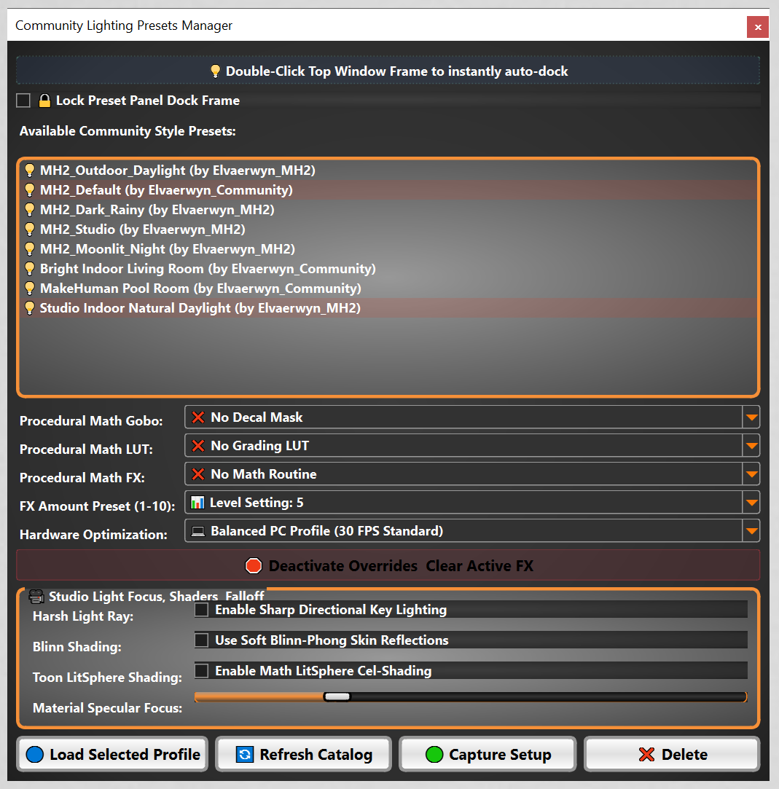

# MH2_Make_Light_Presets  
  
  
  
MH2 Community Style Plugin- Make Light Presets. This is the first of the official community plugins to be available for   
testing purposes.  

~This is an evolving extensive suite of lighting tools for rendering, prop stage use**(info coming soon) etc. Presets, saving,
fx, luts, gobos, etc. 

###
*Drop in plugin* example in extensions(folder structure map):  
this can be one .py or an entire software suite, it can be capable of standing alone or ready to drop in only  
in this mh2 software(**note this is not the same as the official incorporated style plugins).  
###

makehuman2/  
└── extensions/  
    ├── single_file_preset_mod.py      <-- SIMPLE LOOKUP: Just one standalone file dropped in  
    │  
    ├── large_custom_thing_mod/        <-- COMPLEX PACK: Folder-isolated layout architecture  
    │   ├── __init__.py                <-- Tells the application boot core to index this pack  
    │   ├── main.py                    <-- Core runtime initialization and layout script  
    │   ├── texture.png                <-- Root graphical decal asset file  
    │   │  
    │   └── assets/                    <-- DYNAMIC DATA CHANNELS  
    │       ├── stencils/              <-- Target path folder scan channel for stencil masks *example    
    │       │   └── a_stencil.png  
    │       ├── grids/                 <-- Target path folder scan channel for grading grids *example   
    │       │   └── random_grid  
    │       └── lighting_presets/      <-- Automation folder capturing local JSON footprints *example  
    │           └── the_baseline.json  
    │  
    └── cool_thing_mod/                <-- ALTERNATIVE INDEPENDENT PACK  
        └── main.py                    <-- Standalone complex engine entry script  

.json saved lighting presets can be saved, exported and shared. The presets load onto the screen with a double click.

~>Please be aware this is not a stand-alone tool, it requires Makehuman 2 in order to load, to use this you install it in the extensions folder,    
First open up makehuman 2, then pull down the community plugins menu in mh2(settings-community plugins), you should see the plugin panel open up to  
allow any installed extensions to be used. Enable the plugin. At present this should open it right up as a fully dockable window of its own.  

The filename for this to operate is make_light_presets(needs to be exactly this).

  
